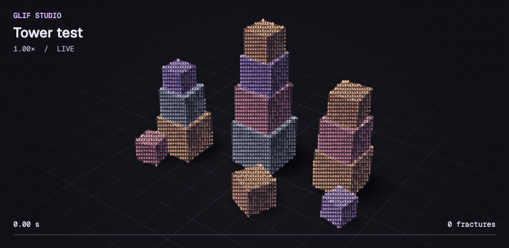

# Glif Studio

Throw a cube into a tower of ASCII characters. Rewind to the instant it breaks, orbit the fragments, and send someone a replay they can explore in their own browser.



The same impact is included as a standalone 3D clip. Download the HTML file and open it in a browser to scrub through the impact or orbit the tower yourself. [Interactive tower replay](docs/tower-replay.html)

## Try it in thirty seconds

Download and extract the repository, then open `index.html` in a modern browser. The physics engine, fonts and renderer ship with the project. The interface is in Turkish.

1. Click **Küp fırlat** to launch a clay cube at the central tower. To throw one yourself, grab a block and release while moving the pointer.
2. Click **Tekrarı izle** to watch the impact. The amber ticks mark fractures. Pause, drag the timeline over a tick and orbit the camera to see which blocks broke in that frame.
3. Choose **Dışa aktar → Tekrarı HTML olarak kaydet**. The saved file contains the recorded 3D poses and a small viewer. Open it offline, change the viewing angle or watch at quarter speed.

## Experiments

| Scene | Try this |
| --- | --- |
| Cube towers | Reset the scene and repeat the first launch with clay, glass and rubber. The material picker applies to newly spawned cubes. |
| Block wall | Switch off fracture to see how an intact wall distributes the same impact. |
| Domino run | Launch the starter cube, then follow the wave from above. |
| Cube rain | Reduce gravity before resetting the scene. Scrub the recording to find the first contact with the floor. |

## Controls

| Action | Input |
| --- | --- |
| Grab and throw | Drag a body and release. Scroll while holding it to change its depth. |
| Orbit | Drag empty space, right-drag, or use arrow keys with the canvas focused. |
| Zoom | Scroll, pinch, or press **+** / **−**. |
| Add or launch a cube | **A** to drop one. **Enter** on the canvas to launch one. |
| Pause or resume | **Space** or the playback button. |
| Change / reset scene | **1–4** / **R**. |
| Step through a recording | Focus the timeline and use the left or right arrow for one recorded frame. |
| Return from replay | **Canlıya dön** resumes the live workspace at the point where you left it. |

The sandbox also exports a PNG or a plain-text ASCII frame. Reduced-motion mode starts the scene and exported viewer paused.

## How it works

- **Physics** advances cannon-es at a fixed 90 Hz. A point constraint attaches to the picked surface point. Recent pointer motion determines release velocity. Impacts above the material's threshold split a block into four rigid pieces that inherit its motion.
- **Rendering** projects box faces into a character grid. A depth buffer chooses the visible surface for each cell. Face lighting selects a glyph and shade from an atlas. The same renderer draws the live view and exported replays.
- **Recording** samples body transforms at 30 Hz and retains up to eight seconds of simulation. Position and orientation are interpolated between samples. Fractures switch the set of visible bodies at a sample boundary. Recording pauses once all bodies are at rest.

During replay, the live simulation waits while you inspect past frames. Return to live play to pick up where you left off.

## Develop locally

Edit the files in `src/` and refresh `index.html`. Node.js 20 or later runs the regression tests and builds the portable edition, using only the Node standard library.

```sh
npm test
npm run build
```

The build writes `dist/Glif-Studio.html`. You can move that file anywhere and open it directly.

| Source | Responsibility |
| --- | --- |
| [world.js](src/world.js) | Presets, materials, fixed time steps, picking and fracture |
| [renderer.js](src/renderer.js) | Projection, lighting, glyph rasterization and depth testing |
| [replay.js](src/replay.js) | Bounded pose recording and interpolation |
| [clip.js](src/clip.js) | Standalone HTML replay player and export |
| [studio.js](src/studio.js) | Pointer, keyboard and touch interaction, transport and UI |
| [physics.test.cjs](test/physics.test.cjs) | Scene stability, material response and replay boundaries |

## Credits

The bundled physics engine is cannon-es 0.20.0. The typefaces are Geist and Geist Mono from the Geist 1.9.2 package. Their license notices are included with the source and the portable build. [cannon-es license](licenses/cannon-es.txt) · [Geist license](licenses/Geist.txt)

## License

Glif Studio is distributed under the [MIT License](LICENSE). The bundled engine and fonts retain the notices listed above.
